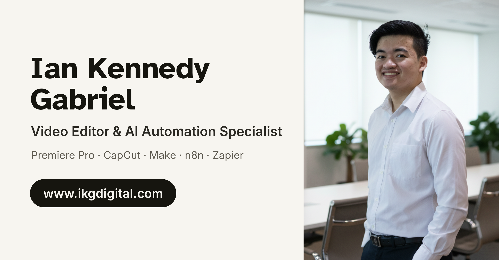

# IKG Digital Portfolio

The source for **[ikgdigital.com](https://www.ikgdigital.com)**, my portfolio as a video editor and AI automation specialist. The site opens on a split screen: video editing on one side, AI automation on the other. Pick a side to see that work.

## What's on the site

**Video editing**
- **Home** (`/video`): an introduction, the formats I edit (AI videos, UGC, feed ads, podcasts), and the tools I edit with
- **Projects** (`/video/projects`): tabs for AI Videos, UGC, Feed Ads, and Podcasts. Each video opens in a player with a short description and the tools used. Podcasts show the full episode next to the clips cut from it.
- **About** (`/video/about`): my background, what I do, and my editing skills and tools

**AI automation**
- **Home** (`/automation`): an introduction, the platforms I build on, and a shelf of certificates that open in a pop-up
- **Projects** (`/automation/projects`): tabs for Make, n8n, Zapier, and GoHighLevel. Each project opens a pop-up with screenshots, Before and After boxes, the result, and a case study.
- **About** (`/automation/about`): my background, what I do, and my skills and tools

**Contact** (`/contact`) is shared by both sides.

A Video / Automation switch in the header moves between matching pages on each side. The site has a light mode by default and a dark mode toggle, and it works on desktop and phone.

## How it's built

The site is one `index.html` file with no framework and no build step. Every page lives inside that file, so moving between pages is instant and nothing reloads. Each page still has its own address (like `/video/projects/ugc`), and older `#` links such as `#about` or `#projects-make` open the right page and switch to the new address.

Images live in `assets/img/`. Videos are hosted on Vimeo (short videos) and YouTube (full podcast episodes) and play in an embedded player.

Headings use Atkinson Hyperlegible and body text uses Inter. The design was inspired by the Athos Framer template.

## Files

| File | Purpose |
|---|---|
| `index.html` | The entire site |
| `assets/img/` | Photos, logos, badges, and certificates used on the site |
| `share.html` | A lightweight page with link-preview tags that sends visitors to the homepage |
| `og-image-v3.png`, `og-image-v3-sm.png` | Current link preview images (older `og-image.png` and `og-image-v2.png` are kept for links already shared) |
| `robots.txt` | Allows search engines to crawl the site |

## Hosting and deployment

The site is hosted on **Cloudflare Pages**, connected to this repo. Every push to `main` deploys automatically, and any deployment can be rolled back from the Cloudflare dashboard. Since the repo has no `404.html`, Cloudflare serves `index.html` for page addresses like `/video/about`, and the site shows the right page.

Before pushing a change, I compare the new files against the current version and screenshot every page on desktop and phone, in light and dark mode, with Playwright, so nothing reaches the live site unchecked.

## Related

- **[automation-workflows](https://github.com/iankgabriel/automation-workflows):** the workflows behind the automation projects on this site, with write-ups, screenshots, and exported files

---

Built by Ian Kennedy Gabriel, IKG Digital. The site's text, images, videos, and project content belong to me. The code is shared here for reference.
